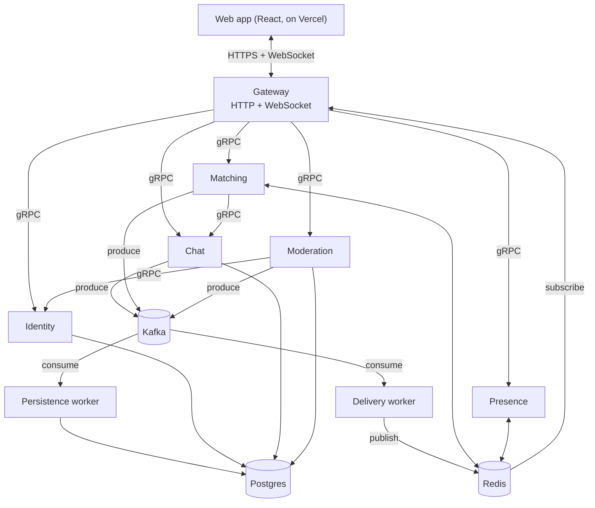
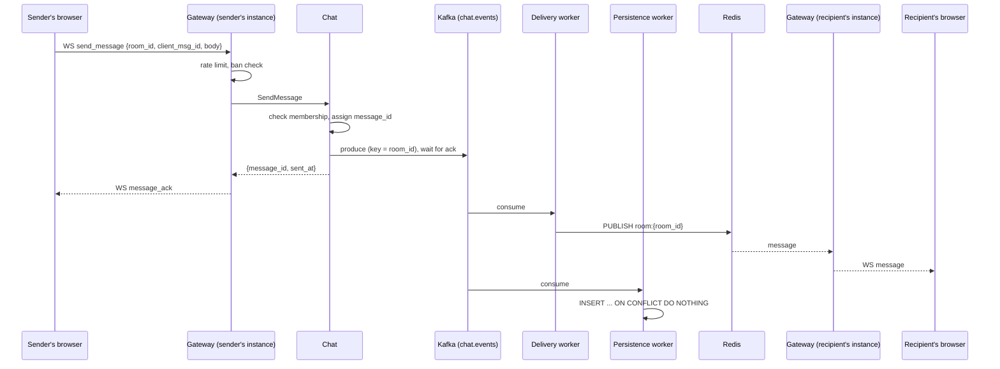

# Architecture: Flamingo Chat

How the system is built and why. Scope is in [PRD.md](PRD.md); the reasoning behind each choice is in [decisions.jsonl](decisions.jsonl), referenced below by ID.

**Status.** Sections marked **Agreed** were decided with the maintainer. Sections marked **Proposed** were drafted on 2026-10-13 so building could continue while the maintainer was away; they are logged with `"status": "proposed"` and need review. Deployment to Google Cloud is summarised in section 12 and will be designed separately.

## 1. Overview



Principles:

- **The gateway is the only public entry point and the whole trust boundary.** Internal services trust the account ID the gateway sends. (DEC-0014)
- **Live delivery goes only through Redis pub/sub.** Redis pub/sub is at-most-once: a message published while a subscriber is disconnected is lost, so clients reload history after reconnecting. (DEC-0015, DEC-0036)
- **Kafka is the single entry point for chat messages and user-facing events.** Producers write to Kafka only. Workers fan out: the delivery worker publishes to Redis for live delivery, the persistence worker writes to Postgres. (DEC-0020, DEC-0037)
- **No streaming gRPC.** Every internal call is a plain request and response. Results that arrive later (a match found, a ban) reach the user through their personal Redis channel. (DEC-0038)
- **Postgres is the source of truth. Redis holds nothing that cannot be rebuilt or lost.**
- **Each service owns its own Postgres schema and migrations**, reached through a repository interface. (DEC-0006)
- **Services are stateless and run as several replicas.** State lives in Postgres, Redis and Kafka.
- **Portable.** Everything runs in Kubernetes and is defined as code; no cloud-specific managed services. (DEC-0023)

## 2. Services (Agreed)

| Service | Responsibility | Owns | Calls |
|---|---|---|---|
| `gateway` | HTTP API, WebSocket connections, sessions, rate limits, origin checks, Redis subscriptions | Nothing persistent | All gRPC services, Redis |
| `identity` | Accounts, pseudonyms, Google verification, gender, guest cleanup | `identity` schema | Postgres |
| `chat` | Rooms, membership, invite codes, sending messages, history, "keep chatting" | `chat` schema, invite cache in Redis | Postgres, Kafka, Redis |
| `matching` | Match queues and pairing | Queue state in Redis | Chat, Kafka, Redis |
| `presence` | Live online counts | Counters in Redis | Redis |
| `moderation` | Reports, blocks, bans, gender change requests, admin actions | `moderation` schema, ban and block sets in Redis | Identity, Postgres, Kafka, Redis |
| `delivery-worker` | Kafka to Redis fan-out for live delivery | Nothing | Kafka, Redis |
| `persistence-worker` | Kafka to Postgres: chat history and analytics | `analytics` schema; writes `chat.messages` | Kafka, Postgres |
| `tools/admin` | Command-line tool for admin actions, run with cluster access | Nothing | Moderation, Identity |

`delivery-worker` and `tools/admin` are new modules. The persistence worker writes chat history into Chat's schema because it is effectively Chat's background half; Chat owns those migrations.

## 3. Data flows

### 3.1 Sending a message (Agreed)



- Keying by room keeps each room's events in order. (DEC-0020)
- Delivery is at-least-once from Kafka, so a client can receive the same `message_id` twice. Clients drop duplicates by `message_id`.
- The sender sees their own message through the same path, so every client renders messages from one source.

### 3.2 Matching (Agreed shape; algorithm built, pending review - DEC-0077 to DEC-0079)

1. The client sends `match_request {preference}`. The gateway calls `Matching.RequestMatch` with the account's tier, gender and pseudonym, which it already holds.
2. Matching looks for a compatible waiting user in one atomic Redis script. If none, the user joins the queue and gets `match_queued`.
3. On a match, Matching calls `Chat.CreateDirectRoom`, then produces `MatchFound` to `matching.events`.
4. The delivery worker publishes `match_found` to both users' channels, `user:{account_id}`. Each user's gateway subscribes to the new room and tells the browser.

Compatibility rules:

- `preference = any` accepts anyone. `preference = male | female` requires the seeker to be verified with a chosen gender of male or female. (DEC-0026, DEC-0028)
- Two users match only if each accepts the other: a seeker who wants female matches only verified female users, and vice versa.
- Never match two users if either blocked the other, or if they were each other's previous partner.
- The script scans the oldest 100 waiting candidates. That is enough at pilot scale and keeps the script bounded.
- Entries older than 10 minutes are dropped; the client asks again. The gateway calls `CancelMatch` when a queued user disconnects.

Queue keys are in section 5.5.

### 3.3 Keep chatting (Agreed scope; mechanics Proposed)

During a random chat, either user can send `keep_chat`. Chat records the vote and produces a `KeepVote` event to the room. The other user is asked (a 25-second question whose default is to keep chatting; saying nothing never saves a chat). When both have voted, the room becomes **kept**: it appears in both users' Inbox under each other's anonymous names and keeps its history, and they can carry on chatting there. A random chat that ends without both votes is closed and disappears for both users. Its messages stay on the server for moderation. (DEC-0031)

If one person leaves first, the other has a short window to save the chat alone. It is then saved for that person only and is **read-only**: it can be read but not messaged. An Inbox chat can also be closed with **Stop messaging** (read-only for both, still readable) or removed with **Delete** (gone from that person's Inbox, closed for the other, who keeps it under the same name). A room that has ended accepts no more messages. (DEC-0091, DEC-0106)

### 3.4 Presence (built, pending review - DEC-0081, DEC-0082)

- Every 15 seconds each gateway instance sends one batched `Heartbeat` with a category per connected account: `GUEST`, `MALE`, `FEMALE` or `VERIFIED_OTHER`.
- Presence stores each category as a Redis sorted set with the last-heartbeat time as the score. It drops entries older than 45 seconds, and every 5 seconds publishes the counts to the `presence` channel.
- Gateways forward the counts to every connected browser.
- Counts are totals only and never identify anyone. Presence counts are not durable events, so they go straight to Redis, not through Kafka.

### 3.5 Reports, blocks and bans (built, pending review - DEC-0083 to DEC-0085)

- **Report.** Moderation stores it and produces `ReportFiled`.
- **Block.** Moderation stores it and adds each account to the other's `avoid:{account_id}` set, which Matching reads - this alone prevents any future match between them. Ending an already-open direct room with the blocked account at the moment of blocking is not yet implemented (DEC-0085); the room ends normally some other way (`Next`, `End`, or not being kept). In group rooms the client hides messages from blocked accounts using `GET /v1/blocks`.
- **Ban** (admin tool only).
  1. Moderation stores the ban, adds the account to the Redis `banned` set and produces `AccountBanned`.
  2. The delivery worker sends `kicked` to `user:{account_id}`, and gateways close that user's connections.
  3. Gateways check `banned` on sign-in, on WebSocket connect, and on every send.
  4. A verified account is one per Google account, so signing in again with the same Google account reaches the same banned account.

## 4. Accounts and sessions (Proposed; built, pending review - DEC-0071 to DEC-0076)

### 4.1 Accounts

- **Guest:** created with a pseudonym. No credentials; the session token in the browser is the only way back in. Deleted after 60 days without activity. (DEC-0026)
- **Verified:** linked to one Google account by its `sub` claim, with `hd == "kiit.ac.in"` and `email_verified == true` checked. Stores `sub` and the email, never the name or picture. (DEC-0027)
- **Gender:** chosen once after verification: male, female or prefer not to say. The server rejects a second change. An admin can change it after a reviewed request. (DEC-0028)

### 4.2 Google sign-in

One RPC, `Identity.SignInWithGoogle(id_token, guest_account_id?)`, covers all three cases:

| Case | Result |
|---|---|
| A verified account already has this `sub` | Return it. A guest account in the browser is left to expire. |
| No account has this `sub`, and a guest account is supplied | Upgrade that guest account in place. Its pseudonym and rooms carry over. |
| No account has this `sub`, and no guest account | Create a verified account with a generated pseudonym such as "Silent Otter". The user can change it. |

The response says whether the account still needs a gender choice.

### 4.3 Sessions

- The gateway issues its own session token: a JWT signed with HMAC-SHA256 using a key from a Kubernetes secret. (DEC-0014)
- Claims: `sub` (account ID), `iat`, `exp`. The token lifetime is 60 days, matching guest retention.
- The token holds no tier or gender. The gateway reads the account from Identity on connect, so changes take effect on the next connection.
- On WebSocket auth, if the token is older than 24 hours, `auth_ok` carries a fresh one. Active users never expire.
- Revocation is through the ban set, so no token deny-list is needed.
- Every authenticated connection calls `Identity.TouchAccount`, at most once an hour per account, to keep `last_seen_at` current for guest cleanup.

### 4.4 Abuse protection

- **CAPTCHA:** guest signup requires a Cloudflare Turnstile token, checked by the gateway. It is turned off when no Turnstile secret is configured, as in local development.
- **Rate limits:** fixed windows on Redis counters, configurable. Starting values:

| Action | Limit |
|---|---|
| Guest signup | 5 per hour per IP |
| Send message | 20 per 10 seconds per account |
| Match request | 30 per minute per account |
| Create group room | 3 per day per account |
| Report | 10 per hour per account |

- **WebSocket origin check:** the gateway accepts connections only from configured origins.
- **No admin surface on the internet.** Admin actions go through `tools/admin` from inside the cluster, and every action is recorded. (DEC-0029)

## 5. Contracts

### 5.1 HTTP API (Proposed; built, pending review - DEC-0072)

JSON over HTTPS, prefix `/v1`. Authenticated endpoints take `Authorization: Bearer <session token>`.

| Method and path | Purpose |
|---|---|
| `POST /v1/auth/guest` | `{pseudonym, turnstile_token}` → `{session_token, account}` |
| `POST /v1/auth/google` | `{id_token}`, with an optional guest session → `{session_token, account, needs_gender}` |
| `GET /v1/me` | Current account |
| `PATCH /v1/me` | `{pseudonym}` |
| `POST /v1/me/gender` | `{gender}`, once |
| `POST /v1/me/gender-change-requests` | `{requested_gender, note}` |
| `GET /v1/presence` | `{total, guests, male, female}` |
| `GET /v1/rooms` | My group rooms, my saved conversations, and my random chat in progress. A direct room carries `partner_pseudonym`, and `ended_at_unix` once it is closed |
| `POST /v1/rooms` | `{name}` → new group room with invite code |
| `POST /v1/rooms/join` | `{invite_code}` |
| `POST /v1/rooms/{id}/leave` | Leave a room. Leaving a direct room (deleting a saved chat) also closes it |
| `POST /v1/rooms/{id}/close` | Stop messaging in a direct room: it stays readable for both but takes no more messages |
| `POST /v1/rooms/{id}/invite-code` | Replace the invite code (owner only) |
| `GET /v1/rooms/{id}/messages?before=&limit=` | History, newest first |
| `POST /v1/reports` | `{reported_account_id, room_id, reason}` |
| `GET /v1/blocks`, `POST /v1/blocks` | List blocks, `{blocked_account_id}` |
| `GET /healthz`, `GET /readyz` | Liveness and readiness |

Errors use `{error: {code, message}}`, with HTTP status codes mapped from gRPC codes.

### 5.2 WebSocket protocol (Proposed; built, pending review - DEC-0073 to DEC-0075)

The endpoint is `GET /v1/ws`. Each frame is a JSON object with a `type` field. The first client frame must be `auth` within 5 seconds; a token is never put in the URL, where it would end up in logs.

Client to server:

| `type` | Fields |
|---|---|
| `auth` | `token` |
| `send_message` | `room_id`, `client_msg_id`, `body` |
| `match_request` | `preference`: `any`, `male` or `female` |
| `match_cancel` | none |
| `match_next` | none (end the current random chat and queue again) |
| `match_end` | none |
| `keep_chat` | `room_id` |
| `sync_rooms` | none (listen to my rooms now: sent after creating or joining a room over HTTP, DEC-0106) |
| `ping` | none |

Server to client:

| `type` | Fields |
|---|---|
| `auth_ok` | `account`, optional fresh `token` |
| `message` | `message_id`, `room_id`, `sender_account_id`, `sender_pseudonym`, `body`, `sent_at`, `client_msg_id` |
| `message_ack` | `client_msg_id`, `message_id`, `sent_at` |
| `match_queued` | none |
| `match_cancelled` | none (sent after every successful `match_cancel`, DEC-0103) |
| `match_found` | `room_id`, `partner_pseudonym`, `partner_account_id` |
| `match_ended` | `room_id`, `reason` |
| `keep_status` | `room_id`, `you`, `partner`, `kept` |
| `keep_requested` | `room_id` (the other person asked to keep this chat, DEC-0106) |
| `room_joined`, `room_left` | `room_id` |
| `presence` | `total`, `guests`, `male`, `female` |
| `kicked` | `reason` |
| `error` | `code`, `message`, optional `client_msg_id` |
| `pong` | none |

Clients reconnect with exponential backoff and jitter, send `ping` every 25 seconds, and after reconnecting load messages newer than the last `message_id` they saw in each open room.

### 5.3 gRPC changes (Proposed; built, pending review - DEC-0054)

Every RPC now has its own `<Method>Request`/`<Method>Response` message, which is what `buf lint`'s STANDARD rules require (the earlier contracts shared message types across RPCs and did not pass it); `buf lint` is clean as of this redesign.

- **identity:** added `SignInWithGoogle`, `SetGender`, `AdminSetGender` and `TouchAccount`. `VerifyBadge` is marked deprecated but kept, with its existing implementation and tests, until the pull request that implements `SignInWithGoogle` removes both together - removing it here would have broken Identity's already-working code in a pull request meant to touch only contracts. Added `GENDER_PREFER_NOT_TO_SAY = 3`; `GENDER_UNSPECIFIED` means "not chosen yet". `Account` gains `google_linked` and `gender_chosen`.
- **chat:**
  - Removed `StreamRoomEvents` and the generic `CreateRoom` (no implementation existed yet, so nothing broke).
  - Added `CreateGroupRoom`, `CreateDirectRoom`, `JoinRoomByCode`, `LeaveRoom`, `RotateInviteCode`, `ListMyRooms`, `ListMessages`, `VoteKeep`, `EndDirectRoom` and `RemoveMember`.
  - `SendMessage` gains `client_msg_id` and `sender_pseudonym`.
- **matching:** `RequestMatch` is now unary, taking `preference`, `verified`, `gender` and `pseudonym`. It always returns `queued = true`; a match, once found, is delivered later over the gateway's WebSocket, the same path for every caller regardless of timing (DEC-0038) - so there is no `MATCHED` response to wait for here. Added `Next`; kept `CancelMatch`.
- **presence:** replaced `int32 gender` with a `Category` enum (`GUEST`, `MALE`, `FEMALE`, `VERIFIED_OTHER`), and `Heartbeat` now takes a batch of entries.
- **moderation:** added `ListBlocks`, `RequestGenderChange`, and the admin RPCs `ListReports`, `ResolveReport`, `BanAccount`, `UnbanAccount`, `ListGenderChangeRequests` and `ResolveGenderChangeRequest`.
- **events (new package `proto/events/v1`):** protobuf payloads for Kafka (section 5.4). This file declares no RPCs, so buf's RPC naming rules do not apply to it.

`buf breaking` could not be turned on in the same pull request as this redesign - it would fail against its own base, since the redesign is intentionally breaking. It is enabled in the pull request immediately after this one lands on `main`.

### 5.4 Kafka topics (Agreed topics; payloads built, pending review - DEC-0043, DEC-0054)

Payloads are protobuf messages from `proto/events/v1`, so their schemas are versioned in the repository with everything else. There is no schema registry.

| Topic | Key | Events | Consumers |
|---|---|---|---|
| `chat.events` | `room_id` | `MessageSent`, `MemberJoined`, `MemberLeft`, `KeepVote`, `RoomKept`, `RoomEnded` | delivery, persistence |
| `matching.events` | `room_id` | `MatchFound`, `MatchEnded` | delivery, persistence |
| `moderation.events` | `account_id` | `ReportFiled`, `UserBlocked`, `AccountBanned`, `AccountUnbanned` | delivery, persistence |

- Each topic is one envelope message with a `oneof`, plus `event_id`, `occurred_at` and trace context headers.
- Consumers commit offsets only after the work is done: at-least-once delivery, made safe by idempotent writes.
- Local development uses 3 partitions per topic and replication factor 1. A single broker cannot replicate. (DEC-0020)

### 5.5 Redis keys and channels (Proposed)

| Key or channel | Type | Purpose |
|---|---|---|
| `room:{room_id}` | channel | Room events to gateways |
| `user:{account_id}` | channel | Match results, keep status, joins, kicks |
| `presence` | channel | Online counts |
| `presence:{category}` | sorted set | Last heartbeat per account |
| `mq:any`, `mq:want:{gender}` | sorted set | Waiting users by enqueue time |
| `mq:entry:{account_id}` | hash | A waiting user's preference, gender and previous partner |
| `invite:{code}` | string | Invite code to room ID cache |
| `match:members:{room_id}` | hash | Both accounts' matching attributes (preference, gender, verified, pseudonym) as of when a direct room was created, so `Next` can re-enqueue the caller without the client resending them - `match_next`'s client frame carries none (§5.2). A 24-hour safety-net TTL, since ending a room through `match_end` instead (§3.2) never visits this key to clean it up (DEC-0078). |
| `banned` | set | Banned account IDs |
| `avoid:{account_id}` | set | Accounts never to match with |
| `rl:{action}:{subject}:{window}` | string | Rate limit counters |

`room:{room_id}` and `user:{account_id}` each carry more than one `proto/events/v1` envelope type (for example `room:{room_id}` carries both `ChatEvent` and `MatchingEvent`'s `MatchEnded`), and all three envelope types share the same field numbers for `event_id`, `occurred_at_unix` and the start of their own `oneof` - protobuf's wire format alone can't tell a consumer which one a given message is; unmarshaling the wrong type doesn't error, it silently produces a wrongly-interpreted but validly-shaped result (DEC-0070, INC-0009). Every message published to either channel is therefore one tag byte - `1` for `ChatEvent`, `2` for `MatchingEvent`, `3` for `ModerationEvent` - followed by the original Kafka message bytes unchanged. delivery-worker and gateway are separate Go modules and can't share a constant for this, so both implement it against this table.

## 6. Data model (Proposed)

| Schema | Table | Key columns |
|---|---|---|
| `identity` | `accounts` | `id`, `pseudonym` (unique), `badge_verified`, `google_sub` (unique), `verified_email` (unique), `gender`, `gender_set_at`, `created_at`, `last_seen_at` |
| `chat` | `rooms` | `id`, `type` (`group` or `direct`), `name`, `owner_account_id`, `invite_code` (unique), `kept`, `created_at`, `ended_at` |
| `chat` | `memberships` | `room_id`, `account_id`, `joined_at`, `left_at` |
| `chat` | `messages` | `message_id` (primary key), `room_id`, `sender_account_id`, `sender_pseudonym`, `body`, `sent_at` |
| `chat` | `keep_votes` | `room_id`, `account_id`, `voted_at` |
| `moderation` | `reports`, `blocks`, `bans`, `gender_change_requests`, `admin_actions` | Who, whom, why, when, outcome |
| `analytics` | `match_events`, `moderation_events` | Event copies for the product measures in the PRD |

- Message IDs are time-ordered UUIDs (version 7), so the primary key also orders by time.
- The existing `accounts` table gains columns through a new migration. Nothing is rewritten.

## 7. Failure handling (Proposed)

| Failure | Behaviour |
|---|---|
| Kafka unavailable | `SendMessage` returns `Unavailable`. The client shows "not sent" and retries with the same `client_msg_id`. Nothing is shown live that was not recorded. |
| Redis unavailable | Live delivery stops. The delivery worker retries with backoff and does not commit offsets, so nothing is lost; it is delivered late. Gateways reconnect to Redis, and clients reload history. |
| Postgres unavailable | The persistence worker retries with backoff without committing, so its lag grows. History and account calls return errors. |
| A gateway instance dies | Its clients reconnect to another instance and reload what they missed. |
| A worker dies | Another replica in the same consumer group takes over its partitions and resumes from the last committed offset. |
| An event that cannot be decoded | Logged and counted, then skipped, so one bad event cannot block a partition. |
| Shutdown (`SIGTERM`) | Stop accepting work, send WebSocket close frames, finish in-flight requests, flush the Kafka producer, then exit. |

Consumer lag, delivery failures and reconnect rates are exported as metrics so these failures are visible. (DEC-0024)

## 8. Observability in the code (Agreed direction)

- Every service exposes Prometheus metrics on a separate port, and logs JSON through `log/slog` with the trace ID on each line. (DEC-0013)
- `pkg/grpclog` grows into the shared choke point for request metrics and trace spans.
- Trace context passes through gRPC metadata and Kafka headers, so one trace follows a message from browser to database.

The monitoring stack (where metrics, traces and logs are stored and viewed) is designed with the deployment.

## 9. Local development (Agreed; built and verified against a real kind cluster)

- **Tilt** runs everything on a local **kind** Kubernetes cluster inside Docker, using the same Kubernetes files as the real deployment. (DEC-0039, DEC-0053)
- `tilt up` builds each service image, deploys Postgres, Redis, Kafka and every service, creates the Kafka topics, and forwards ports to the host. `tilt ci` does the same once and exits, for scripting; it currently reports every workload healthy.
- The web app will run on the Vite dev server at `http://localhost:8000`, one of the origins registered for Google sign-in - not built yet (§10 is implemented, §11's frontend tests are not).
- Kubernetes files: one shared Helm chart for the Go services (`deploy/helm/service`, with a values file per service under `deploy/helm/service/values/`), and plain manifests for local Postgres, Redis and Kafka under `deploy/k8s/dev` (including the one-time `kind create cluster` config and the Kafka topic-creation Job). Each service has its own multi-stage `Dockerfile`, building from the repository root into a `gcr.io/distroless/static-debian12:nonroot` image (DEC-0053). `persistence-worker` and the delivery worker are not part of this yet - they have no consume loop to run until the Chat and worker PRs land, so Tilt would just watch them crash-loop for no reason.
- `deploy/docker-compose.yml` has been removed; Tilt covers everything it used to.
- **Development-only Google verifier (Proposed, DEC-0049).** With `DEV_FAKE_GOOGLE=1`, Identity accepts tokens of the form `fake:<sub>:<email>`, so verified flows can be tested without a browser. It logs a warning at startup and is never enabled outside local development. Not built yet.

## 10. Frontend (Agreed; redesigned - DEC-0105)

Look: a light "pop brutal" theme (cream paper, thick ink outlines, hard offset shadows), the maintainer's own logo, and a cat-shaped blob mascot on prompts and empty screens.

- A React + Vite + TypeScript single-page app in `web/`, deployed to Vercel. It talks only to the gateway. (DEC-0032, DEC-0040)
- **Welcome:** one question, "Have you been here before?". A new visitor goes straight in as a guest with a made-up name, with no form and no sign-in. A returning one signs in with Google.
- **Desktop:** a real app layout, with navigation, the online count and the profile in a left column, a controls or list pane next to it, and the conversation on the right.
- **Phone:** one pane at a time, with the navigation along the bottom.
- Screens:
  - **Random:** matching, with the gender filters locked until the person has a verified identity.
  - **Channels:** group rooms.
  - **Inbox:** kept conversations.
  - **Chat header:** Keep, Next, End and Report. Block is not offered yet: the old button only ended the chat, which End already does, and wiring the real block endpoint is still open.
- **Identity prompt:** reaching for a locked feature opens a short, warm card that leads with what stays private. Google's own sign-in button sits in a "Get your identity" panel that opens on tap. Declining shows the person what others would see of them, which is only their anonymous name.
- **Gender:** asked once, right after a first Google sign-in, with a friendly note that it can only be set once. (DEC-0028)
- **Online count:** the number beside the green dot is the `presence` frame the gateway already pushes, and before the first one arrives the public `GET /v1/presence`. No backend change.
- Run it without the whole local stack: `npm run dev:mock` and `npm run dev` in `web/`. The mock gateway is a stand-in for working on the UI, not a model of the real gateway's rules.

## 11. Testing (unit/integration tests Agreed and built; the end-to-end smoke test built, pending review - DEC-0087, DEC-0088)

- **Unit tests:** business logic against in-memory fakes of each repository and client interface, as Identity does now. Run in CI with the race detector.
- **Integration tests:** behind the `integration` build tag, run against the real Postgres, Redis and Kafka in the local cluster. Fakes do not reproduce real database behaviour. (INC-0003)
- **End-to-end smoke test:** a Go module in `tests/e2e` that drives the gateway over HTTP and WebSocket. It covers:
  - two guests matching, chatting, keeping the chat, and reading history
  - a group room joined by invite code
  - a report, a block, and a ban through the admin tool
  - a verified user through the development-only verifier
- **Frontend:** type checking, a production build, and unit tests for the connection and message state logic.
- **Load tests** come with the deployment. Their results are committed with their method. (DEC-0025)

## 12. Deployment (Agreed - DEC-0099)

Decided:

- Kubernetes on Google Cloud, paid from the trial credit, which ends 2026-12-25. Move off between 2026-12-15 and 2026-12-18. (DEC-0023)
- The Google sign-in client lives in its own project with no billing. (DEC-0030)
- The frontend runs on Vercel. (DEC-0032)
- A neutral project domain. (DEC-0033)
- Monitoring runs before launch. (DEC-0024)

Agreed for the closed beta (DEC-0099):

```
student browser ──HTTPS──▶ Vercel (web app, <name>.vercel.app)
       │
       └──HTTPS / WSS──▶ Cloudflare (flamingo-api.aranyadutta.dev, TLS)
                            │  Cloudflare Tunnel (outbound from the cluster; no public IP, no open port)
                            ▼
              GKE Standard, zonal asia-south1-a, one e2-standard-2 node
                cloudflared ─▶ gateway ─▶ identity / chat / matching / presence / moderation
                                 Postgres + Kafka (StatefulSets on persistent disks), Redis (in memory)
                                 delivery-worker, persistence-worker
                                 Prometheus + Grafana + Loki + Alloy (Grafana not public)
```

- **Cluster:** `deploy/gke/create-cluster.sh`. One 8 GiB node: the whole dev stack measured 2.83 GiB and peaked at 5.16 GiB over a day that included rollouts and an extra test database (DEC-0099 has the query). On the real node (2026-10-23, `kubectl describe node` and `kubectl top node` right after creation): 5.88 GiB and 1.93 CPU allocatable, of which GKE's own pods reserve 1.02 GiB and 517m and use 956 MiB; everything `deploy/prod/deploy.sh` installs requests 2.24 GiB and 710m (summed from the rendered manifests, Prometheus and Alertmanager included). Google's managed Prometheus and workload logging are off since the cluster runs its own (DEC-0095). About $70 a month at catalog prices (DEC-0099 has the breakdown).
- **Data stores:** `deploy/k8s/prod/`. Postgres and Kafka keep their data on persistent disks (INC-0020: Kafka's image would otherwise lose it on every restart); Redis holds only caches, queues and pub/sub, so it stays in memory.
- **Hostnames (DEC-0102):** `flamingo-api.aranyadutta.dev` is gateway, so every API call, the WebSocket and Google's sign-in callback; `flamingo.aranyadutta.dev` is the static homepage, privacy notice and terms on Cloudflare Pages that Google's brand verification checks (DEC-0100). The web app itself stays on Vercel's own subdomain.
- **Entry point:** a Cloudflare Tunnel is the only way in, so gateway trusts Cloudflare's `CF-Connecting-IP` for the client's address (`CLIENT_IP_HEADER`); otherwise every student would share one rate limit.
- **Configuration:** each service's `values/prod/<name>.yaml` overlays its dev values and removes every dev-only setting; secrets are Kubernetes Secrets made by `deploy/prod/create-secrets.sh`. `deploy/prod/check-render.py` refuses a render that still carries dev settings (INC-0021).
- **Pipeline:** `.github/workflows/images.yml` builds every image on merge to `main` and pushes it to GitHub Container Registry, tagged with the commit SHA. The packages stay private and the cluster pulls them with the `ghcr-pull` Secret (DEC-0101). Deploying is a deliberate `deploy/prod/deploy.sh <sha>`, never automatic.

Not covered yet: alert routing, Postgres backups, and the move off Google Cloud.

## 13. Open questions

- Retention periods for messages, moderation records and analytics.
- Who moderates during the pilot besides the maintainer.
- Whether integration tests should also run in CI, using service containers.
